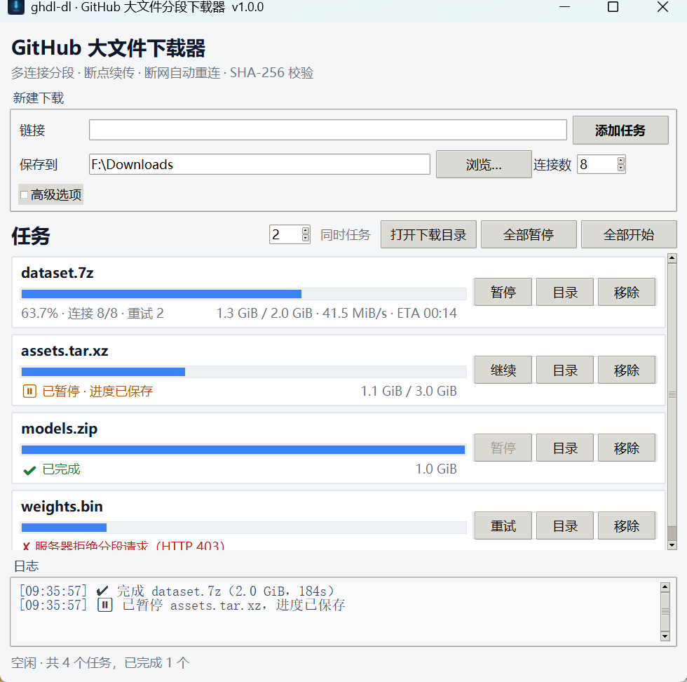

# ghdl-dl · GitHub 大文件分段下载器

[简体中文](README.md) | [English](README.en.md)

[](https://github.com/c4h2o/ghdl-dl/actions/workflows/ci.yml)
[](LICENSE)
[](pyproject.toml)

专为 **GitHub Release 大文件（1 GB 以上）** 设计的下载工具：把文件切成多段并发下载，
断网/超时/连接被重置后**自动重连并续传**，下完自动校验。

纯 Python 标准库实现，运行时零依赖。提供**图形界面**和**命令行**两种用法。

---

## 特性

- **分段并发**：默认 8 个连接，动态领段，先下完的线程继续领新段。
- **断点续传**：每段进度实时落盘（fsync + 原子替换），暂停、崩溃、重启后从断点继续。
- **断线自动重连**：默认无限重试、指数退避；有进展就立刻续传，不空等。
- **签名地址刷新**：GitHub CDN 地址过期（403/404）时自动回原始链接换新地址，多线程共享。
- **完整性校验**：支持 `--sha256`；Release 资源自动读取 GitHub 官方 digest；校验通过才改名。
- **两种落盘模式**：默认预分配单文件按偏移写（无需二次拼接）；`--parts` 每段一个文件后拼接。
- **单流降级**：不支持 `Range` 的链接（如源码包）自动退化为单连接顺序下载并提示。
- **图形界面**：任务列表、速度/ETA、暂停/继续/重试、任务持久化、启动自动续传。
- **网络适配**：HTTP(S) 代理、`HTTPS_PROXY`、GitHub Token、TLS 证书错误提示。
- **Windows 适配**：文件锁、DPI、UTF-8 控制台，提供双击启动的 `.bat`。

## 安装

需要 **Python 3.9+**。图形界面用 `tkinter`（Windows / macOS 官方安装包自带；
Debian/Ubuntu 需 `sudo apt install python3-tk`）。

### 方式一：下载 Release（免安装）

1. 到 [Releases](https://github.com/c4h2o/ghdl-dl/releases) 下载最新压缩包并解压；
2. Windows 双击 `start-gui.bat`（图形界面）或 `start-cli.bat`（命令行）；
3. 其它系统运行 `python run_gui.py` / `python run_cli.py --help`。

启动脚本会自动在 PATH 里找 Python，也可以用任意 3.9+ 的 Python 直接运行 `.py` 文件。

### 方式二：pip 安装

```bash
git clone https://github.com/c4h2o/ghdl-dl.git
cd ghdl-dl
pip install .
# 或者：pipx install .

ghdl-dl --version
ghdl-dl-gui
```

> 发行名使用 `ghdl-dl`，避免与 [GHDL](https://github.com/ghdl/ghdl)（VHDL 仿真器）重名；
> 安装后的命令是 `ghdl-dl` / `ghdl-dl-gui`，Python 包名仍是 `ghdl`，`python -m ghdl` 也可用。

### 方式三：直接跑源码

```bash
git clone https://github.com/c4h2o/ghdl-dl.git
cd ghdl-dl
python run_cli.py --help
python run_gui.py
```

## 快速开始

### 图形界面（推荐）



双击 **`start-gui.bat`**（或运行 `ghdl-dl-gui`）。

1. 粘贴 GitHub 链接（支持一次粘贴多个，每行一个）；
2. 选择保存目录、连接数（建议 8，网络差可 12–16）；
3. 点“添加任务”，任务会自动开始；
4. 断网、休眠、关掉软件都没关系——重新打开后任务会自动继续（进度保存在磁盘上）。

界面里可以单个任务“暂停/继续/移除”，也可以“全部暂停/全部开始”。任务列表会记住上次的任务和保存目录。

### 命令行

```bat
:: 默认保存到当前目录，文件名取自服务器
ghdl-dl https://github.com/owner/repo/releases/download/v1.0/big.zip

:: 指定目录、12 个连接
ghdl-dl <URL> -o D:\Downloads -n 12

:: 指定文件名 + 校验
ghdl-dl <URL> -o D:\Downloads\big.zip --sha256 0123...（64 位十六进制）

:: 只看文件多大、是否支持分段
ghdl-dl <URL> --info

:: 私有仓库 / 避免 API 限流
ghdl-dl <URL> --token ghp_xxx

:: 走本地代理（也支持 HTTPS_PROXY 环境变量）
ghdl-dl <URL> -x http://127.0.0.1:7890

:: 每段单独存一个文件，下完再拼接（默认是直接写同一个文件，更省空间）
ghdl-dl <URL> --parts
```

用源码运行时把 `ghdl-dl` 换成 `python run_cli.py` 即可；也可以双击 **`start-cli.bat`**，
把链接和参数接在后面。

中断（Ctrl+C）= 暂停：会保存进度并以退出码 `3` 结束；**重新执行同一条命令即可续传**。
再按一次 Ctrl+C 才是强制退出。

---

## 为什么能解决“GitHub 下到一半就断”

| 问题 | 解决方式 |
| --- | --- |
| 单连接速度慢、容易断 | 默认 8 个连接各自用 HTTP `Range` 下不同的段，互不影响；一条断了只重试那一段 |
| 断了要重下 | 每段已写入的字节数实时记在 `.ghdlpart.json` 里，重连后从断点继续，不重下已完成的部分 |
| GitHub 的下载地址是**临时签名地址**，几分钟就过期 | 遇到 403/404 自动回到原始链接重新换取新地址，然后用新地址继续原来的段 |
| 断网后程序直接退出 | 默认**无限重试** + 指数退避（1s→30s），网络恢复后自动继续；界面显示“等待重连” |
| 下完发现文件损坏 | 支持 `--sha256` 校验；GitHub Release 资源还能自动从官方 API 取 SHA-256 比对 |
| 想确认下的是不是完整的 | 先按 `Content-Length` / `Content-Range` 校验总大小，再校验哈希，全部通过才改名为最终文件 |

## 实测

从 GitHub Release 下载 `jq-1.7.1`（962 KiB，8 段并发）：下载完成后可直接运行
`jq --version` → `jq-1.7.1`。同一环境下单连接下载同样的文件 5 分钟都没下完——
这正是“分段并发 + 断线续传”要解决的问题。

48 MB 文件下到 64.6% 时强制结束进程，重新运行 3.2 秒续完，文件逐字节一致。

---

## 工作原理

### 1. 探测

先发一个 `Range: bytes=0-0` 的请求（只取 1 字节），从响应里拿到：

* 文件总大小（`Content-Range` / `Content-Length`）；
* 服务器是否支持 Range（返回 `206` 才支持）；
* 真实文件名（`Content-Disposition`）；
* GitHub 签名 CDN 的真实地址（跟随 302）。

### 2. 分段 + 并发

把文件按 `chunk` 切分放进队列，N 个工作线程各领一段：

```
[0, 8M) [8M, 16M) [16M, 24M) ... [last]
  线程1    线程2      线程3          线程8
```

先下完的线程继续领剩下的段（动态负载均衡），不会出现“7 个线程等 1 个慢段”。
每段用 `Range: bytes=start-end` 请求，服务器返回 `206 Partial Content`。

### 3. 落盘

默认模式：预先创建目标大小的 `.ghdlpart` 文件，各线程用 `pwrite`（Windows 上是
`lseek + write`，加锁）**直接写到文件对应偏移**。下载完成时文件本身就是拼好的，
不需要再读一遍写一遍，也不额外占一份磁盘空间。

`--parts` 模式：每段写 `part_00000.bin`、`part_00001.bin`……，全部完成后按顺序
拼接成最终文件（会多占一份临时空间）。适合网络盘/某些杀毒软件对大文件随机写不友好的场景。

### 4. 续传状态

和 `.ghdlpart` 同目录的 `.ghdlpart.json` 记录：

```json
{
  "url": "https://github.com/...",
  "size": 1500000000,
  "chunk_size": 46875000,
  "ranges": true,
  "chunks": [[0,46875000,46875000], [46875000,93750000,12000000], ...],
  "sha256": "...."
}
```

* 每 5 秒 `fsync` 数据后原子替换状态文件（先写 `.tmp` 再 `os.replace`），
  所以断电最多重下几秒的数据，不会出现“状态说下完了、文件其实是空洞”；
* 用文件锁防止两个进程同时写同一个文件；进程崩溃时锁由操作系统自动释放；
* 重启后校验 `URL / 总大小 / 分段布局` 是否仍一致，一致才续传，否则提示重新开始。

### 5. 断线重连

* 所有连接层错误（超时、连接重置、DNS 失败、5xx）都重试；
* **有进展就立刻从断点续传**（不退避）；完全没有进展才退避：1s、2s、4s……最多 30s，带随机抖动；
* 默认无限重试，`--retries N` 可限制次数；
* 签名地址过期（403/404）会重新解析原始链接，其它线程看到地址已更新会直接复用，不会一起重复刷新；
* 连续多次无法连接时界面显示“网络中断，等待恢复…”，网络恢复后自动继续。

### 6. 校验与收尾

下载完成后：

1. 校验最终文件大小；
2. 有 SHA-256（你提供的，或 GitHub API 里的官方 digest）就流式计算并比对；
3. 全部通过才 `os.replace` 成最终文件名，删除进度文件；
4. 校验失败**不会**删除数据，会告诉你文件留在哪里，方便排查/重试。

---

## 命令行参数

| 参数 | 说明 |
| --- | --- |
| `URL ...` | 一个或多个下载链接 |
| `-o, --output` | 保存为文件或目录；多个链接时必须是目录。以 `/` 或 `\` 结尾会强制当目录 |
| `-n, --connections` | 并发连接数，默认 8 |
| `--chunk-size` | 分段大小，如 `8M`、`16MiB`；默认按“每个连接约 4 段”自动计算 |
| `--sha256` | 下载完成后校验 SHA-256 |
| `--token` | GitHub Token，默认读 `GITHUB_TOKEN` / `GH_TOKEN` 环境变量 |
| `-x, --proxy` | HTTP(S) 代理；不填时自动读 `HTTPS_PROXY` / `ALL_PROXY` |
| `--timeout` | 连接/读取超时秒数，默认 30 |
| `--retries` | 每段最大重试次数，`0`（默认）= 一直重试 |
| `--retry-base` / `--retry-max` | 退避起始/上限秒数，默认 1 / 30 |
| `--parts` | 每段单独文件，完成后拼接 |
| `--restart` | 删除已有进度重新下载 |
| `--no-resume` | 忽略已有进度（但保留文件） |
| `--force` | 目标文件已存在也重新下载 |
| `--no-api` | 不查询 GitHub API 获取官方 SHA-256 |
| `--insecure` | 跳过 TLS 证书校验（仅用于证书有问题的公司网络） |
| `--info` | 只显示文件大小、是否支持分段 |
| `-q / -v` | 安静 / 详细日志 |

退出码：`0` 成功（含已存在跳过）；`1` 失败；`2` 参数错误；`3` 已暂停（可续传）。

---

## 常见问题

**Q：为什么 GitHub 源码压缩包（`github.com/用户/仓库/archive/...zip`）不能分段？**

这类文件是服务器**动态打包**的，不支持 `Range`，也没有固定大小。程序会自动退化为
单流下载并提示“断线后只能从头下载”。Release 里上传的附件（`/releases/download/...`）
都支持 Range，可以放心用多线程。需要下载源码包时，建议先在本地/CI 打成 Release 附件。

**Q：私有仓库怎么写？**

在 GitHub 设置里生成一个有 `repo` 权限的 Token，然后 `--token ghp_xxx`（或设环境变量
`GITHUB_TOKEN`）。注意：Token 只发送给 `github.com` 系列域名，不会发给签名 CDN。

**Q：连接数开多少合适？**

一般 8 就足够；GitHub 对单 IP 有带宽/频率限制，开太多（比如 32）可能触发 429，反而更慢。
国内网络建议配合代理，8–16 个连接。

**Q：下载到 99% 卡住？**

某个段一直失败。程序会持续重试并显示重试次数；可以 `--retries 10` 让它尽快报错，
或稍后重跑（已下载部分不会丢）。也可能是磁盘满了。

**Q：`.ghdlpart` / `.ghdlpart.json` 是什么？**

未完成任务的临时数据和进度。**不要手动删**，删了就要重下。下载成功后会自动清理。
实在要清理：先关闭程序，删除这两个文件（以及 `.ghdlparts` 目录），再重新下载。

**Q：提示 `CERTIFICATE_VERIFY_FAILED` / TLS 证书校验失败？**

说明当前网络（常见于公司/校园网代理、抓包工具）替换了 HTTPS 证书，而它的根证书没有装进系统。
处理方式：把代理软件的根证书安装到“受信任的根证书颁发机构”，或设置正确的 `--proxy`；
实在不行可临时加 `--insecure`（会跳过证书校验，只建议在可信网络里用）。

**Q：Windows 提示路径太长？**

Windows 默认 260 字符限制。把保存目录改短一些，或开启系统的长路径支持。

**Q：杀毒软件报毒/写入变慢？**

本工具不修改系统、不驻留后台。若杀毒软件实时扫描大文件导致速度慢，可把下载目录加入白名单。

---

## 目录结构

```
ghdl-dl/
├─ start-gui.bat           # 双击启动图形界面
├─ start-cli.bat           # 双击启动命令行
├─ run_gui.py              # GUI 入口
├─ run_cli.py              # CLI 入口
├─ pyproject.toml          # 打包/命令入口
├─ ghdl/
│  ├─ assets/              # 图标（SVG/PNG/ICO）与社交预览图
│  ├─ engine.py            # 核心：分段、并发、续传、重试、校验、组装
│  ├─ http_client.py       # 极简 HTTP 客户端（重定向/Range/代理/Token/TLS）
│  ├─ probe.py             # 探测大小、Range、文件名、GitHub API 摘要
│  ├─ writer.py            # 单文件随机写 / 分片写 / 单流写
│  ├─ model.py             # 分段模型、状态持久化、文件锁
│  ├─ cli.py               # 命令行与进度条
│  └─ gui.py               # tkinter 图形界面
├─ tools/make_icon.py      # 重新生成图标/社交预览
├─ tests/
│  ├─ server.py            # 模拟断流/签名过期/限流/无 Range 的测试服务器
│  └─ test_engine.py       # 17 个引擎测试
├─ docs/RELEASING.md       # 发布流程
└─ .github/                # CI、Release、Issue/PR 模板
```

## 开发 / 测试

```bash
python -m unittest discover -s tests -t . -v
```

测试会在本地起一个 HTTP 服务器，覆盖：正常分段、连接反复中断、签名地址过期后刷新、
服务器 503 后恢复、不支持 Range、chunked 无长度、分片模式拼接、SHA-256 不匹配、
暂停后续传、已存在跳过等场景。详见 [CONTRIBUTING.md](CONTRIBUTING.md)。

## 许可协议

本项目使用 [MIT License](LICENSE)。

你可以自由地使用、修改、分发、商用、再发布，只需保留版权声明和许可证文本，且作者不承担担保责任。
如果要在公司内使用但需要专利授权条款，可以考虑 Apache-2.0；要强制衍生作品开源则用 GPL-3.0。

## 贡献与安全

- 贡献指南：[CONTRIBUTING.md](CONTRIBUTING.md)
- 安全问题请走私密渠道：[SECURITY.md](SECURITY.md)
- 发布流程：[docs/RELEASING.md](docs/RELEASING.md)

## 说明

* 仅使用 HTTP 标准能力（Range/重定向），不依赖 GitHub 私有接口；请遵守 GitHub 服务条款，
  不要对同一资源开过高并发。
* 默认连接数 8，已尽量在“速度”和“不给 GitHub 添麻烦”之间取平衡。
* 代码兼容 Python 3.9+（开发环境 3.12），Windows / macOS / Linux 均可运行，
  Windows 下额外做了文件锁、DPI、控制台 UTF-8 适配。
